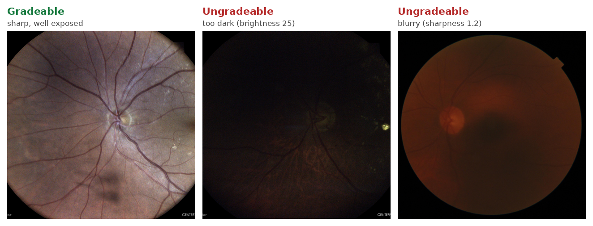
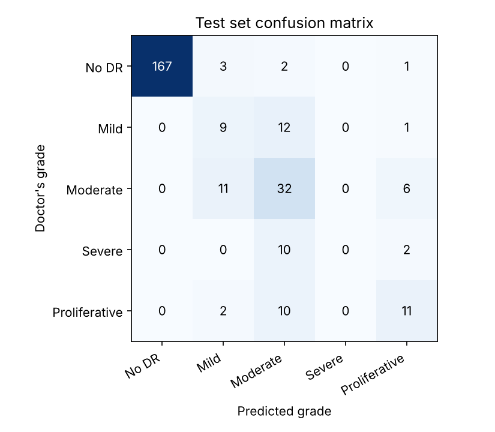

# Retinal Image Quality Sorter & DR Grader

A two-step screening pipeline for retinal (fundus) photos:

1. **Quality check:** sort photos into **Gradeable** and **Ungradeable** so doctors only review photos they can diagnose from, and patients with a bad photo can be re-imaged on the spot.
2. **Disease grading:** estimate diabetic retinopathy (DR) severity, from 0 (none) to 4 (proliferative), for the gradeable photos.

The project started during a data-science training program at **SDAIA** (Saudi Data & AI Authority) in 2024, working with retinal screening images from Saudi clinics.

> **Disclaimer:** This is a research and education project. It is **not a medical device**, has **not been clinically validated**, and must not be used to diagnose patients or make referral decisions. Any "refer" output is illustrative only.



## Contents

| File | What it does |
|---|---|
| `sort_images.py` | Sorts a folder of photos into `Gradeable/` and `Ungradeable/`, with a reason for each rejection |
| `quality.py` | The quality measurements and decision rule |
| `evaluate_sorter.py` | Measures the sorter against human gradability labels and tunes its thresholds |
| `grading/train_grader.py` | Trains and evaluates the DR severity grader |
| `pipeline.py` | Runs both steps on a folder: quality check, then grade |
| `experiments/` | Scripts behind the results reported below |
| `results/` | Saved outputs of those scripts |

## Quick start

```bash
pip install -r requirements.txt
python sort_images.py examples --dry-run
```

```
gradeable    gradeable.jpg  (passed all checks)  brightness=112.8, diameter=3464px, sharpness=160.94
ungradeable  ungradeable_blurry.jpg  (blurry)  brightness=60.7, diameter=1910px, sharpness=1.17
ungradeable  ungradeable_too_dark.jpg  (too dark)  brightness=24.5, diameter=3382px, sharpness=29.02
```

Without `--dry-run`, copies of the photos are placed in `sorted/Gradeable/` and `sorted/Ungradeable/`.

---

## Step 1: Quality check

### How it works

The retina is located first, by finding the bright circle on the black background. Every measurement is then taken **inside the retina only**, so the black border doesn't skew the results.

| Check | Measurement | Default | Catches |
|---|---|---|---|
| Brightness | Mean HSV value inside the retina | 50 – 240 | Underexposed or saturated photos |
| Resolution | Retina diameter in pixels | ≥ 400 px | Thumbnails with too few pixels to grade |
| Sharpness | Variance of the Laplacian of the green channel (×1000), after placing the retina on a square canvas, resizing it to 512 px and blurring it | ≥ 3.5 | Out-of-focus and washed-out photos |

Notes on the sharpness check:
- **Square canvas:** cameras often cut off the top and bottom of the retina. The visible part is padded rather than stretched, so the geometry is the same for every photo.
- **Resizing to a fixed size** makes scores comparable between cameras.
- **The blur is deliberately strong.** It removes sensor grain and JPEG compression artifacts, so the score reflects structures at the scale of blood vessels, not how the file was saved. With a lighter blur, re-saving a blurry photo at low JPEG quality was enough to make it look sharp (see below).
- **The green channel** is used because vessels have the most contrast there.

A photo is gradeable only if it passes every check. The sorter also detects **exact duplicate files** and can skip them.

```
python sort_images.py INPUT_DIR [--output DIR] [--report results.csv] [--dry-run]
    --min-brightness 50   --max-brightness 240   --min-diameter 400   --min-sharpness 3.5
    --skip-duplicates     --move                 --legacy  (original v2 rule, for comparison)
```

### Results

**SDAIA sample (51 photos, 35 unique).** The sorter marks 29 as gradeable and 22 as ungradeable: 13 too dark and 9 blurry. These are exactly the same decisions as the original v2 rule, but now each rejection comes with a reason based on the photo itself, not its file size. Blurry photos that aren't too dark score at most 1.4 for sharpness; gradeable photos score at least 51.

**Decisions should depend on the photo, not the file** ([`experiments/robustness_check.py`](experiments/robustness_check.py), [output](results/robustness_check.txt)). I re-saved each of the 35 unique photos twice: as a low-quality JPEG (quality 60, shrunk to at most 2,000 px wide, never enlarged) and as a quality-100 JPEG:

| Rule | Low-quality JPEG | Quality-100 JPEG |
|---|---|---|
| v2 (file size + whole-image brightness) | 0 / 35 changed | **10 / 35 changed**: blurry photos became "gradeable" just because the file got bigger |
| v3 with a light sharpness blur (earlier version) | **7 / 35 changed**: compression artifacts made blurry photos look sharp | 0 / 35 |
| v3 (current) | **0 / 35** | **0 / 35** |

**Stress test on 1,450 doctor-graded photos from other cameras.** These photos come from the DR grading dataset below. Doctors graded every one of them, so a good quality check should reject almost none.
- **First defaults** (minimum diameter 1,000 px, and a sharpness check on an earlier, lighter-blur scale) rejected **364** of them. 331 were rejected for low resolution, but grading accuracy on those photos was just as good as on the rest ([output](results/quality_vs_grading.txt)). The resolution rule was really detecting the camera, the same problem the file-size rule had.
- **Current defaults** reject **0** of the 1,450 ([output](results/stress_test_current_defaults.txt)), and still produce the same 29/22 split on the SDAIA sample. The lowest sharpness among them is 6.6, compared with the 3.5 threshold and at most 1.9 for the blurry SDAIA photos, even after re-saving them.

### Measuring it against labels

```bash
python evaluate_sorter.py IMAGE_DIR labels.csv --tune
```

This reports accuracy, balanced accuracy, how many gradeable photos were kept, and how many ungradeable photos were rejected. With `--tune` it searches for better thresholds using 5-fold cross-validation, so the reported estimate isn't measured on the same photos the thresholds were tuned on. It reads the SDAIA metadata format (`Image`, `gradability`) by default.

---

## Step 2: Disease grading

### Approach

The grader uses **transfer learning with a frozen backbone**:
1. Each photo is cropped to the retina, padded to a square and resized to 320 px.
2. The photo and its mirror image are passed through **ResNet18 pretrained on ImageNet** (ONNX Model Zoo weights, run with OpenCV, so no deep-learning framework is needed).
3. The 512 features from the final pooling layer go to a **logistic regression** with balanced class weights.
4. Its regularisation strength is chosen by **5-fold cross-validation** on the 1,171 training and validation photos. The 279 test photos are used only once, for the numbers below.

```bash
python grading/train_grader.py \
    --train-csv train.csv --train-dir train_images \
    --val-csv valid.csv   --val-dir val_images \
    --test-csv test.csv   --test-dir test_images
```

### Test results (279 photos)

| Metric | Result |
|---|---|
| **Any DR vs none** | AUC **0.997**, sensitivity **1.00**, specificity **0.965** |
| **Referable DR** (grade 2 or higher) | AUC **0.942**, sensitivity 0.845, specificity 0.918 |
| 5-grade agreement (quadratic weighted kappa) | **0.828** |
| 5-grade accuracy | 0.785 (always guessing "no DR" would score 0.620) |



The model reliably separates healthy from diseased eyes. Telling the disease grades apart is harder: it never predicts **Severe**, because only 7 of the training photos are grade 3, and it often confuses Mild and Moderate. Full metrics are in [`results/grader/metrics.json`](results/grader/metrics.json).

### Full pipeline

```bash
python pipeline.py IMAGE_DIR --grader results/grader/grader.joblib --out screening.csv
```

Each photo is either flagged for **re-imaging** or given a **grade, a confidence, and a refer / don't-refer suggestion**. These suggestions are illustrative only (see the disclaimer at the top). The `grader.joblib` model file is created by `train_grader.py`. It isn't included in the repo because it's derived from the training data.

---

## Limitations and next steps

- **The sorter's thresholds are set from two small sets plus visual inspection, not from gradability labels.** The sharpness gap is clear on these sets (blurry photos score at most 1.9 even after re-saving, while the softest doctor-graded photo scores 6.6, against a threshold of 3.5), but they come from only a few cameras. The SDAIA metadata includes clinician gradability labels for 1,332 photos, and running `evaluate_sorter.py --tune` on those is the most important next step.
- **Brightness can't tell "vivid" from "washed out".** A strongly lit but crisp photo and a fully washed-out one can have the same brightness. The sharpness check currently catches the washed-out case. A contrast or colour-saturation measure would be a more direct test.
- **The grader's backbone is frozen.** Fine-tuning ResNet18 end to end on a GPU (with augmentation) would likely improve the distinction between grades, especially Mild vs Moderate.
- **There are too few severe cases.** Only 7 training photos are grade 3. More data, or merging grades into "refer / don't refer", would help.
- **The grader dataset is small and imbalanced.** 85% of the training photos are grade 0, while the test split has much more disease (38%). The numbers above come from one fixed split and should be read as a first estimate.

## Project history

1. **v1:** file size only. Anything under 1 MB was considered ungradeable.
2. **v2:** added a whole-image HSV brightness check, lowered the size threshold to 109 KB, and parallelised the processing.
3. **v3 (current):**
   - Measurements are taken inside the retina only.
   - File size is replaced by resolution and sharpness. Sharpness is measured at blood-vessel scale, so JPEG compression doesn't affect it.
   - Added duplicate detection and an evaluation and tuning tool.
   - Thresholds were stress-tested on doctor-graded photos.
   - Added the DR grader and the full pipeline.

## Data

**No datasets are included.**
- The SDAIA screening images and metadata contain clinical information that can't be shared.
- The grading experiments used 1,450 retinal photos labelled 0–4 in the format of the APTOS 2019 Blindness Detection dataset (`id_code`, `diagnosis`), provided as a course task.
- The `examples/` folder contains three sample photos, with camera metadata removed, so the sorter can be run out of the box.
- The ResNet18 weights ([ONNX Model Zoo](https://github.com/onnx/models), Apache-2.0) are downloaded automatically on first use and checked against a SHA-256 checksum. If the download link ever stops working, download `resnet18-v1-7.onnx` from the ONNX Model Zoo yourself and place it in `models/`.

## License

The **code** is released under the [MIT License](LICENSE). The retinal photographs in `examples/`, and the preview image built from them, come from clinical screening data and are **not** covered by the license. They're included only to demonstrate the tool and may not be reused or redistributed.
